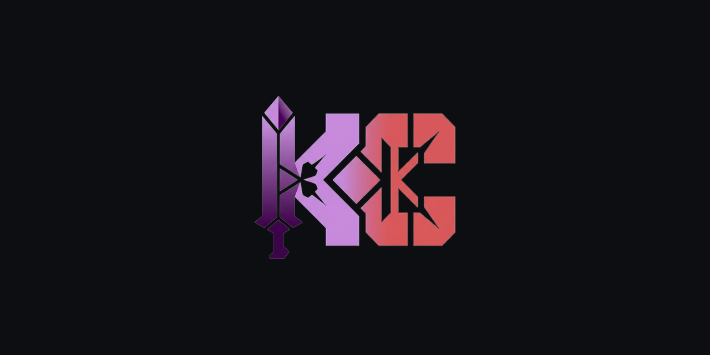
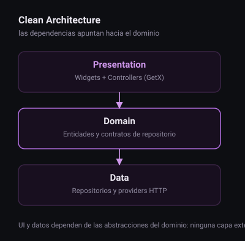

<a id="top"></a>

<div align="center">



<h1>TareaSUD Music</h1>

<p><strong>App móvil de práctica: Flutter con Clean Architecture y GetX, de la estructura al test.</strong></p>

<p>
  
  
  
  <a href="https://github.com/KapsCa/TareaSUD---Musica/releases"></a>
</p>

<p>
<a href="#que-hace"><strong>Qué hace</strong></a> &bull;
<a href="#arquitectura"><strong>Arquitectura</strong></a> &bull;
<a href="#stack"><strong>Stack</strong></a> &bull;
<a href="#instalacion"><strong>Instalación</strong></a> &bull;
<a href="#testing"><strong>Testing</strong></a>
</p>

</div>

---

<p>
Tarea de desarrollo móvil para <strong>sudSolutions</strong>: una app pequeña y real para ejercitar el stack
completo — navegación, estado, red, capas y pruebas — en lugar de un producto final. El alcance es
deliberadamente acotado; la exigencia está en cómo está construida.
</p>

## Qué hace

- Navega un catálogo musical con pantallas independientes por módulo.
- Separa presentación, dominio y datos: el controlador no sabe de HTTP y el repositorio no sabe de widgets.
- Consume una API externa con `http` y expone los resultados a través de contratos del dominio.
- Incluye suite de pruebas sobre la capa de aplicación.

## Arquitectura



El código vive en `lib/app`, organizado por módulos y no por tipo de archivo:

```
lib/
└── app/
    ├── core/       utilidades compartidas, tema y constantes
    ├── data/       repositorios y acceso a datos
    ├── modules/    una carpeta por funcionalidad (pantalla + controlador)
    └── routes/     declaración de rutas y navegación
```

La regla es una sola: las dependencias apuntan hacia el dominio. Cambiar el cliente HTTP no obliga a tocar la UI, y cambiar una pantalla no obliga a tocar los datos.

## Stack

| Pieza | Elección |
|---|---|
| SDK | Flutter `^3.6.0` |
| Estado e inyección | GetX `^4.7.2` (bindings por módulo) |
| Red | `http` `^1.6.0` |
| Lint | `flutter_lints` `^5.0.0` |
| Plataformas | Android, iOS, web, Linux, macOS, Windows |
| Releases | `release-please` con Conventional Commits |

## Instalación

```bash
git clone git@github.com:KapsCa/TareaSUD---Musica.git
cd TareaSUD---Musica
flutter pub get
flutter run
```

## Testing

```bash
flutter test
```

## Releases

El repositorio usa `release-please`. Los mensajes de commit siguen
[Conventional Commits](https://www.conventionalcommits.org/): `feat:` para funcionalidad, `fix:` para
defectos, `docs:` y `chore:` para el resto. Cada release se genera automáticamente desde `main`.

## Estado

Prototipo de práctica, mantenido como referencia de estructura. Alberga la marca KapsCa en
`assets/brand/` y el header de presentación es una copia vendida del kit.
